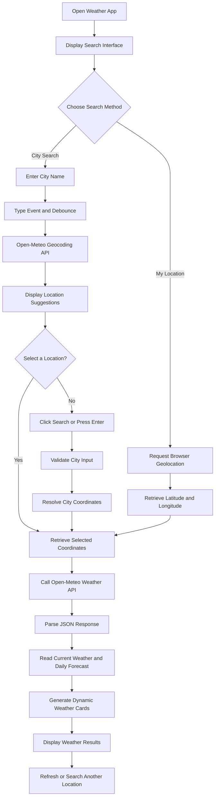

# Weather App 
## Real-Time Weather Information and Forecast Application

A responsive, browser-based weather application built with HTML5, CSS3, and Vanilla JavaScript. Powered by the Open-Meteo Geocoding and Weather APIs, the application allows users to search for cities, explore location suggestions, access weather information using device geolocation, and view current weather conditions alongside a 7-day forecast.

## Live Demo

[View Weather-App](https://aminbiography.github.io/weather-app/)

---

## Project Overview

The Weather App is a web-based application designed to retrieve and display weather information for different geographical locations.

It uses the Open-Meteo Geocoding API to identify cities and retrieve their geographical coordinates. These coordinates are subsequently used with the Open-Meteo Weather API to obtain current weather conditions and daily forecast information.

Users can search for a city by entering its name, select a suggested location while typing, or use their device's geolocation to retrieve weather information for their current position.

The application dynamically renders weather information through JavaScript DOM manipulation. It displays the current temperature, wind speed, local update time, and a 7-day forecast containing maximum temperature, minimum temperature, and precipitation.

The interface uses CSS Flexbox, responsive media queries, interactive controls, and an animated loading indicator to provide a consistent experience across desktop and mobile devices.

The application does not require an API key for its current Open-Meteo integration.

## Project Objectives

- Explore the core principles of weather application development using JavaScript.
- Understand how geographical locations are resolved through a geocoding service.
- Apply asynchronous JavaScript to retrieve external API data.
- Practice HTTP requests, JSON parsing, and dynamic DOM manipulation.
- Implement city search with real-time location suggestions.
- Explore browser geolocation and coordinate-based weather retrieval.
- Apply event handling, conditional logic, and asynchronous request management.
- Develop responsive interfaces using CSS Flexbox and media queries.
- Understand API response structures and the relationship between geographical coordinates and weather information.
- Support coding exploration, research, and practical experimentation with frontend development and external API integration.

## Key Features

- **City-Based Weather Search:** Search for weather information using a city name.
- **Location Suggestions:** Displays up to five matching geographical locations while typing.
- **Geocoding Integration:** Resolves city names into geographical coordinates.
- **Current Weather Information:** Displays current temperature and wind speed.
- **7-Day Weather Forecast:** Presents daily maximum and minimum temperatures alongside precipitation totals.
- **Device Geolocation:** Uses the browser Geolocation API to retrieve the user's current coordinates.
- **Enter Key Support:** Allows users to initiate a city search by pressing Enter.
- **Refresh Functionality:** Clears the current results and prepares the interface for another search.
- **Asynchronous API Requests:** Uses JavaScript `async/await` and the Fetch API.
- **Duplicate Search Avoidance:** Reuses previously resolved location coordinates when the same search is performed again.
- **Debounced Suggestions:** Delays autocomplete requests to reduce unnecessary API calls while typing.
- **Stale Request Protection:** Uses request tokens to prevent outdated geocoding responses from replacing newer results.
- **Loading Indicator:** Displays an animated spinner while weather information is being retrieved.
- **Dynamic DOM Rendering:** Updates the weather display without reloading the page.
- **Responsive Forecast Layout:** Uses flexible forecast cards that adapt to different screen sizes.
- **No API Key Required:** Uses Open-Meteo services without requiring an API key for the current implementation.

## Weather Information Displayed

| Weather Information | Description | Data Source |
|---|---|---|
| Location | Selected city or current location label | Open-Meteo Geocoding / Browser Geolocation |
| Current Temperature | Current temperature in Celsius | Open-Meteo Weather API |
| Wind Speed | Current wind speed in km/h | Open-Meteo Weather API |
| Last Updated | Localized date and time of the weather observation | Open-Meteo Weather API |
| Forecast Date | Individual forecast dates | Open-Meteo Weather API |
| Maximum Temperature | Daily maximum temperature in Celsius | Open-Meteo Weather API |
| Minimum Temperature | Daily minimum temperature in Celsius | Open-Meteo Weather API |
| Precipitation | Daily precipitation total in millimeters | Open-Meteo Weather API |

---

## Functional Logic and Code Architecture

The application is implemented within a single `index.html` file containing the HTML structure, embedded CSS, and JavaScript functionality.

This section explains the application's functional components, JavaScript variables, event listeners, API integrations, data processing, and execution logic.

### 1. HTML Document Initialization

The application starts with a standard HTML5 document structure.

```html
<!DOCTYPE html>
<html lang="en">
<head>
    <meta charset="UTF-8">
    <meta name="viewport" content="width=device-width, initial-scale=1.0">
    <title>Weather App By aminbiography</title>
</head>
<body>
    <!-- Weather application interface -->
</body>
</html>
```

**Implementation details:**

- `<!DOCTYPE html>` declares the HTML5 document type.
- `lang="en"` identifies English as the document language.
- `charset="UTF-8"` specifies character encoding.
- The viewport meta tag supports responsive rendering.
- The title element defines the browser tab title.

The document contains the application's CSS and JavaScript internally rather than loading separate stylesheet or JavaScript files.

### 2. CSS Variables and Background Styling

The `:root` selector defines reusable CSS custom properties.

```css
:root {
    --bg1: #343533;
    --bg2: #85ff00;
}
```

These variables represent the two primary background colors.

The body uses a linear gradient:

```css
body {
    font-family: Arial, system-ui;
    background: linear-gradient(to bottom, var(--bg1), var(--bg2));
    color: #fff;
    margin: 0;
    padding: 20px;
    text-align: center;
}
```

**Logical behavior:**

1. CSS variables store reusable color values.
2. The body selector applies the overall application styling.
3. `linear-gradient()` creates a vertical color transition.
4. The text color is set to white for contrast.
5. Padding provides spacing around the interface.
6. Center alignment establishes the primary content arrangement.

### 3. Search Control Layout

The `.bar` class organizes the city input and action buttons.

```css
.bar {
    display: flex;
    flex-direction: column;
    align-items: center;
    gap: 10px;
    width: 100%;
    max-width: 180px;
    margin: 0 auto 10px;
}
```

The layout uses:

- `display: flex` to enable Flexbox.
- `flex-direction: column` to stack controls vertically.
- `align-items: center` to center the controls.
- `gap: 10px` to maintain consistent spacing.
- `max-width: 180px` to constrain the control container.

The `.suggest-wrap` class provides a positioning context for the autocomplete dropdown.

### 4. Weather Results Container

The `#weather` selector defines the main weather display area.

```css
#weather {
    margin: 16px auto 0;
    background: rgba(0, 0, 0, .2);
    padding: 18px;
    border-radius: 10px;
    min-width: 280px;
    width: min(100%, 920px);
    min-height: 380px;
    max-width: 860px;
}
```

This container displays the weather results and forecast cards.

Its properties provide:

- A semi-transparent background.
- Rounded corners.
- Internal spacing.
- A minimum height for the results area.
- Flexible width constraints.
- Centered horizontal positioning.

### 5. Forecast Card Layout

The `.forecast` class organizes daily forecast cards using Flexbox.

```css
.forecast {
    display: flex;
    flex-wrap: wrap;
    gap: 10px;
    justify-content: center;
    margin-top: 16px;
}
```

Each `.day` element represents one forecast date.

```css
.day {
    flex: 1 1 140px;
    min-width: 120px;
    max-width: 100%;
    background: rgba(255, 255, 255, .2);
    border-radius: 8px;
    padding: 10px;
}
```

**Layout behavior:**

1. Forecast cards are arranged horizontally when sufficient space is available.
2. `flex-wrap: wrap` allows cards to move onto additional rows.
3. `gap` maintains spacing between cards.
4. Flexible sizing allows cards to adapt to the available container width.

### 6. Responsive Design Logic

The application uses CSS media queries to adjust forecast card widths for smaller devices.

```css
@media (max-width: 480px) {
    .day {
        width: 100%;
        min-width: 100%;
    }
}
```

A separate media query also targets screens up to 380 pixels.

**Responsive behavior:**

- Larger screens display multiple forecast cards in flexible rows.
- Screens up to 480 pixels display forecast cards at full available width.
- Smaller screens maintain a single-column forecast arrangement for readability.

### 7. Autocomplete Dropdown Styling

The `.suggest` class defines the location suggestion dropdown.

Its CSS properties include:

- Absolute positioning below the city input.
- A dark background.
- A border and rounded corners.
- A shadow effect.
- A maximum height.
- Scrollable overflow.
- A higher stacking order using `z-index`.

The `.suggest.hidden` selector hides the dropdown when suggestions are not available or should no longer be displayed.

The `.suggest-item` class styles each individual suggestion and applies a hover background when the pointer moves over it.

### 8. Animated Loading Indicator

The `.spin` class creates a circular loading indicator using CSS borders and animation.

```css
.spin {
    display: inline-block;
    width: 16px;
    height: 16px;
    border-radius: 50%;
    border: 2px solid rgba(255, 255, 255, .35);
    border-top-color: #fff;
    animation: spin 1s linear infinite;
}
```

The `@keyframes spin` rule rotates the indicator.

```css
@keyframes spin {
    to {
        transform: rotate(360deg);
    }
}
```

This provides visual feedback during asynchronous geocoding and weather requests.

### 9. HTML Interface Components

The main application interface contains the following elements:

| Element ID / Class | Responsibility |
|---|---|
| `cityInput` | Accepts the city name |
| `suggest` | Displays geographical search suggestions |
| `searchBtn` | Initiates city search |
| `geoBtn` | Retrieves the device's current location |
| `refreshBtn` | Clears previous weather results |
| `weather` | Displays current weather and forecast information |
| `suggest-wrap` | Positions the autocomplete dropdown |

The application also provides Enter key support for initiating searches from the city input field.

### 10. JavaScript State Variables

The application declares several variables to manage location information, search behavior, and asynchronous requests.

```javascript
let lastLocation = null;
let lastQuery = "";
let activeGeoReq = 0;
let typingTimer = null;
```

**Variable responsibilities:**

| Variable | Purpose |
|---|---|
| `lastLocation` | Stores the most recently retrieved location coordinates and label |
| `lastQuery` | Stores the previous city search query |
| `activeGeoReq` | Tracks the active geocoding request to identify outdated responses |
| `typingTimer` | Stores the timeout reference used for debounced suggestions |

These variables help coordinate the application's search and request-management logic.

### 11. DOM Element Selection

The JavaScript implementation retrieves important HTML elements using `document.getElementById()`.

```javascript
const cityInput = document.getElementById('cityInput');
const suggestBox = document.getElementById('suggest');

const searchBtn = document.getElementById('searchBtn');
const geoBtn = document.getElementById('geoBtn');

const weatherBox = document.getElementById('weather');
const refreshBtn = document.getElementById('refreshBtn');
```

These references allow JavaScript to:

- Read the user's search input.
- Display or hide location suggestions.
- Attach event listeners to buttons.
- Update the weather results.
- Change button visibility and disabled states.

### 12. Event Listener Configuration

The application connects its interface components to JavaScript functions using `addEventListener()`.

```javascript
searchBtn.addEventListener('click', handleSearchClick);
geoBtn.addEventListener('click', useMyLocation);
refreshBtn.addEventListener('click', refreshWeather);

cityInput.addEventListener('keydown', (e) => {
    if (e.key === 'Enter') {
        e.preventDefault();
        handleSearchClick();
    }
});

cityInput.addEventListener('input', onType);
```

A document-level click listener also hides the autocomplete dropdown when a user clicks outside the suggestion container.

**Event handling responsibilities:**

- Search button click: Executes `handleSearchClick()`.
- Geolocation button click: Executes `useMyLocation()`.
- Refresh button click: Executes `refreshWeather()`.
- Enter key: Initiates a city search.
- Input event: Initiates the debounced suggestion process.
- Outside click: Closes the location suggestion dropdown.

### 13. Function: `onType()`

The `onType()` function handles changes in the city input field.

```javascript
function onType() {
    clearTimeout(typingTimer);

    const q = cityInput.value.trim();

    if (q.length < 2) {
        hideSuggest();
        return;
    }

    typingTimer = setTimeout(() => showSuggestions(q), 220);
}
```

**Logical execution:**

1. `clearTimeout()` cancels a previously scheduled suggestion request.
2. The input value is retrieved and trimmed.
3. The function checks whether the query contains at least two characters.
4. If the query is too short, the suggestion dropdown is hidden.
5. Otherwise, a new timeout is scheduled.
6. After 220 milliseconds, `showSuggestions(q)` is executed.

This technique is called **debouncing**.

It reduces unnecessary geocoding requests when users type multiple characters quickly.

### 14. Function: `showSuggestions(q)`

The `showSuggestions()` function retrieves matching geographical locations from the Open-Meteo Geocoding API.

```javascript
async function showSuggestions(q) {
    const token = ++activeGeoReq;

    const res = await fetch(
        `https://geocoding-api.open-meteo.com/v1/search?name=${encodeURIComponent(q)}&count=5&language=en`
    );

    if (!res.ok) {
        throw new Error('Geocoding failed');
    }

    const data = await res.json();

    if (token !== activeGeoReq) return;

    if (!data.results || data.results.length === 0) {
        hideSuggest();
        return;
    }

    // Render location suggestions
}
```

**Logical execution:**

1. A new request token is generated.
2. The city query is encoded using `encodeURIComponent()`.
3. A GET request is sent to the Open-Meteo Geocoding API.
4. The response status is checked through `res.ok`.
5. The response is converted into JSON using `res.json()`.
6. The request token is compared with the latest active token.
7. If the request is outdated, its result is ignored.
8. If no matching locations exist, the suggestion dropdown is hidden.
9. Otherwise, the returned geographical locations are prepared for display.

The request uses `count=5`, limiting the autocomplete response to five matching locations.

Each result combines available location information:

- City name.
- Administrative region.
- Country.

The generated suggestion elements store latitude and longitude in their `data-*` attributes.

### 15. Location Suggestion Selection

Each suggestion receives a click event listener.

When a user selects a location:

1. Latitude is retrieved from `dataset.lat`.
2. Longitude is retrieved from `dataset.lon`.
3. The selected location label is retrieved from `dataset.label`.
4. The input field is updated with the selected location.
5. The suggestion dropdown is hidden.
6. `performWeatherFetch()` is called with the selected coordinates and label.

This allows users to retrieve weather information directly from a suggestion without performing another city-name geocoding request.

### 16. Function: `hideSuggest()`

The `hideSuggest()` function controls the autocomplete dropdown.

```javascript
function hideSuggest() {
    suggestBox.classList.add('hidden');
    suggestBox.innerHTML = "";
}
```

It performs two operations:

- Adds the `hidden` class to the suggestion container.
- Clears previously generated suggestion elements.

This prevents outdated suggestions from remaining visible after a selection or when the user clicks outside the search area.

### 17. Function: `handleSearchClick()`

The `handleSearchClick()` function manages manual city searches.

It is executed when the user clicks Search or presses Enter.

**Logical execution:**

1. Retrieves the entered city name.
2. Removes leading and trailing whitespace.
3. Checks whether the query contains at least two characters.
4. Displays an alert if the input is too short.
5. Checks whether the query matches the previous search.
6. If the same query already has a stored location, reuses that location.
7. Otherwise, displays a loading message.
8. Disables the search button during geocoding.
9. Generates a new request token.
10. Sends a request to the Open-Meteo Geocoding API.
11. Converts the response into JSON.
12. Ignores outdated requests.
13. Checks whether a matching city exists.
14. Extracts geographical coordinates and location information.
15. Stores the current query.
16. Calls `performWeatherFetch()` with the resolved location.
17. Handles errors and restores the search interface.

The search request uses `count=1`, so the first matching geographical result is selected automatically when the user submits a city name.

If no matching result exists, the application displays:

`City not found. Try a more specific name.`

### 18. Duplicate Search Avoidance

The application uses `lastQuery` and `lastLocation` to avoid repeating the geocoding process for an identical search.

```javascript
if (q.toLowerCase() === lastQuery.toLowerCase() && lastLocation) {
    performWeatherFetch(lastLocation);
    return;
}
```

**Logical behavior:**

1. The current query is converted to lowercase.
2. It is compared with the previously stored query.
3. The application checks whether a previous location is available.
4. If both conditions are satisfied, the stored coordinates are reused.
5. The weather request is executed directly.

This reduces unnecessary geocoding requests while allowing the application to retrieve updated weather information.

### 19. Request Token and Stale Response Protection

The `activeGeoReq` variable is used to distinguish between current and outdated geocoding requests.

```javascript
const token = ++activeGeoReq;

const res = await fetch(geocodingUrl);
const data = await res.json();

if (token !== activeGeoReq) return;
```

This approach helps prevent a previous geocoding response from updating the interface after a newer request has already been initiated.

For example:

1. A user types a city name.
2. The application starts a geocoding request.
3. The user changes the search input.
4. A newer geocoding request starts.
5. The earlier response may arrive after the newer request.
6. The request-token comparison identifies the earlier response as outdated.

The same request-token mechanism is used by the suggestion and manual city-search workflows.

### 20. Function: `useMyLocation()`

The `useMyLocation()` function retrieves the user's geographical coordinates through the browser Geolocation API.

```javascript
function useMyLocation() {
    if (!navigator.geolocation) {
        alert('Geolocation not supported.');
        return;
    }

    setLoading(true, 'Getting your location…');

    searchBtn.disabled = geoBtn.disabled = true;

    navigator.geolocation.getCurrentPosition(
        async pos => {
            const { latitude, longitude } = pos.coords;

            performWeatherFetch({
                lat: latitude,
                lon: longitude,
                label: 'Your Location'
            });
        },
        err => {
            setLoading(false);
            searchBtn.disabled = geoBtn.disabled = false;
            alert('Failed to get your location.');
        },
        {
            enableHighAccuracy: true,
            timeout: 10000
        }
    );
}
```

**Logical execution:**

1. Checks whether the browser supports geolocation.
2. Displays a location retrieval message.
3. Disables the search and geolocation buttons.
4. Calls `navigator.geolocation.getCurrentPosition()`.
5. Waits for the browser to retrieve the current coordinates.
6. Extracts latitude and longitude from `pos.coords`.
7. Calls `performWeatherFetch()` using those coordinates.
8. If location retrieval fails, restores the controls and displays an alert.

The geolocation configuration requests high-accuracy coordinates and defines a timeout of 10 seconds.

**Browser requirement:** Geolocation generally requires a secure context, such as HTTPS, and permission from the user.

### 21. Function: `performWeatherFetch(loc)`

The `performWeatherFetch()` function is the primary weather retrieval and rendering function.

It receives an object containing:

- `lat`: Latitude.
- `lon`: Longitude.
- `label`: Location name displayed in the results.

The function constructs a weather API URL using these coordinates.

```javascript
const url = `https://api.open-meteo.com/v1/forecast?latitude=${loc.lat}&longitude=${loc.lon}&current_weather=true&daily=temperature_2m_max,temperature_2m_min,precipitation_sum&timezone=auto`;
```

**API request parameters:**

| Parameter | Purpose |
|---|---|
| `latitude` | Specifies the geographical latitude |
| `longitude` | Specifies the geographical longitude |
| `current_weather=true` | Requests current weather information |
| `daily=temperature_2m_max` | Requests daily maximum temperature |
| `daily=temperature_2m_min` | Requests daily minimum temperature |
| `daily=precipitation_sum` | Requests daily precipitation totals |
| `timezone=auto` | Requests automatic timezone handling |

The application sends the request using:

```javascript
const res = await fetch(url, { cache: 'no-store' });
```

The `cache: 'no-store'` option requests that the browser does not use a cached response for this request.

**Response processing:**

```javascript
const data = await res.json();

const cw = data.current_weather;
const daily = data.daily;

if (!cw || !daily) {
    throw new Error('Unexpected API response');
}
```

The JSON response is separated into two main objects:

- `cw`: Current weather information.
- `daily`: Daily forecast information.

The application checks that both objects are available before generating the results.

### 22. Dynamic Weather Result Rendering

After receiving the API response, the application constructs HTML dynamically using a JavaScript template literal.

The current weather section displays:

- Selected location.
- Last updated time.
- Current temperature in Celsius.
- Current wind speed in kilometers per hour.

The daily forecast is generated using:

```javascript
daily.time.map((d, i) => {
    // Generate a forecast card
});
```

**Logical execution:**

1. `daily.time` provides the forecast dates.
2. `map()` iterates through the dates.
3. The current array index identifies the corresponding forecast values.
4. Maximum temperature is retrieved from `daily.temperature_2m_max[i]`.
5. Minimum temperature is retrieved from `daily.temperature_2m_min[i]`.
6. Precipitation is retrieved from `daily.precipitation_sum[i]`.
7. A forecast card is generated for each date.
8. `join('')` combines the generated card strings into one HTML string.
9. `weatherBox.innerHTML` updates the weather display.

This approach allows the application to render forecast information dynamically without manually creating individual forecast elements in HTML.

### 23. Function: `setLoading(on, text)`

The `setLoading()` function provides visual feedback while the application retrieves information.

```javascript
function setLoading(on, text = '') {
    if (on) {
        weatherBox.innerHTML = `<p>${text} <span class="spin"></span></p>`;
    }
}
```

**Logical behavior:**

1. Receives a Boolean parameter named `on`.
2. Receives a message through the `text` parameter.
3. Checks whether loading is enabled.
4. If `on` is true, updates the weather container with the message and animated spinner.
5. If `on` is false, the function does not modify the weather container.

The function is called during city resolution, geolocation, and weather retrieval.

The existing implementation relies on subsequent rendering or error messages to replace the loading display.

### 24. Function: `formatLocal(iso)`

The `formatLocal()` function converts an ISO date-time string into a localized date and time representation.

```javascript
function formatLocal(iso) {
    const d = new Date(iso);

    return d.toLocaleString(undefined, {
        weekday: 'short',
        month: 'short',
        day: 'numeric',
        hour: '2-digit',
        minute: '2-digit'
    });
}
```

**Logical execution:**

1. Receives the date-time string from the weather API.
2. Creates a JavaScript `Date` object.
3. Uses `toLocaleString()` to format the date and time.
4. Displays the abbreviated weekday and month.
5. Includes the day, hour, and minute.

The resulting value is displayed in the weather results as the update time.

### 25. Function: `escapeHtml(s)`

The `escapeHtml()` function converts potentially special HTML characters into their corresponding escaped representations.

```javascript
function escapeHtml(s) {
    return String(s).replace(/[&<>"']/g, c => ({
        '&': '&amp;',
        '<': '&lt;',
        '>': '&gt;',
        '"': '&quot;',
        "'": '&#39;'
    }[c]));
}
```

**Logical execution:**

1. Converts the supplied value into a string.
2. Searches for special HTML characters.
3. Replaces each matched character with its escaped representation.
4. Returns the resulting string.

This function is used when displaying location labels in generated HTML, including autocomplete suggestions and weather headings.

It helps prevent location text from being interpreted as HTML markup.

### 26. Function: `refreshWeather()`

The `refreshWeather()` function resets the current search interface.

Its operations include:

- Hiding the suggestion dropdown.
- Clearing the city input.
- Clearing the previous weather results.
- Hiding the refresh button.
- Resetting `lastLocation`.
- Resetting `lastQuery`.
- Returning focus to the city input.

The source code currently declares `refreshWeather()` twice.

The second declaration overrides the first declaration because both functions have the same name in the same script scope.

The effective implementation is:

```javascript
function refreshWeather() {
    hideSuggest();

    cityInput.value = "";
    weatherBox.innerHTML = "<p>Cleared. Enter a city to load new weather.</p>";

    refreshBtn.style.display = "none";

    lastLocation = null;
    lastQuery = "";

    cityInput.focus();
}
```

This is the function executed when the Refresh button is clicked.

### 27. Error Handling and Conditional Logic

The application uses `try`, `catch`, and `finally` blocks in its asynchronous search and weather retrieval functions.

**Error-handling responsibilities:**

- Checks API response status through `res.ok`.
- Handles failed geocoding requests.
- Displays a message when a city cannot be found.
- Checks for missing current weather or daily forecast data.
- Displays an error message when weather retrieval fails.
- Handles browser geolocation failures.
- Restores relevant button states after operations.

The application also uses conditional checks to control search length, location availability, response validity, and the visibility of interface components.

---

## Application Execution Flow

The following diagram illustrates the primary workflow from city input to weather display.



### Application Workflow Summary

1. The user opens the application.
2. The user enters a city name or selects the current-location option.
3. The application resolves the location through the Geocoding API or browser geolocation.
4. Latitude and longitude are passed to the weather retrieval function.
5. The Open-Meteo Weather API returns current and daily forecast information.
6. JavaScript processes the JSON response.
7. The weather container is updated dynamically.
8. The user can refresh the interface or perform another search.

## API Integration

The application uses two Open-Meteo services.

### 1. Open-Meteo Geocoding API

The Geocoding API converts city names into geographical information.

**Endpoint:**

`https://geocoding-api.open-meteo.com/v1/search`

**Example request:**

`https://geocoding-api.open-meteo.com/v1/search?name=London&count=5&language=en`

The application uses this service for:

- Searching city names.
- Generating location suggestions.
- Retrieving latitude and longitude.
- Identifying administrative regions and countries.

### 2. Open-Meteo Weather API

The Weather API retrieves current weather conditions and daily forecast data.

**Endpoint:**

`https://api.open-meteo.com/v1/forecast`

**Example request:**

`https://api.open-meteo.com/v1/forecast?latitude=51.5072&longitude=-0.1276&current_weather=true&daily=temperature_2m_max,temperature_2m_min,precipitation_sum&timezone=auto`

The application uses this service to retrieve:

- Current temperature.
- Current wind speed.
- Weather observation time.
- Daily maximum temperature.
- Daily minimum temperature.
- Daily precipitation totals.

**API Documentation:**

- [Open-Meteo Geocoding API](https://open-meteo.com/en/docs/geocoding-api)
- [Open-Meteo Weather API](https://open-meteo.com/en/docs)

## Technologies Used

| Technology | Purpose |
|---|---|
| HTML5 | Application structure and interface elements |
| CSS3 | Visual design, gradients, layout, and responsive styling |
| Vanilla JavaScript | Application logic and interactive functionality |
| JavaScript DOM API | Element selection, event handling, and dynamic rendering |
| JavaScript Fetch API | External API communication |
| JavaScript Async/Await | Asynchronous request handling |
| Open-Meteo Geocoding API | City search and geographical coordinate resolution |
| Open-Meteo Weather API | Current weather and daily forecast retrieval |
| Browser Geolocation API | Retrieval of device coordinates |
| GitHub Pages | Static website hosting |

## Project Structure

```text
weather-app/
│
└── index.html
```

### File Responsibilities

| File | Description |
|---|---|
| `index.html` | Contains the complete HTML interface, embedded CSS, JavaScript functions, API integrations, and weather rendering logic |

The current repository uses a single-file implementation rather than separate HTML, CSS, and JavaScript files.

## Getting Started

### Prerequisites

- A modern web browser.
- Git installed on your computer.
- A code editor such as Visual Studio Code.
- Internet access for Open-Meteo API requests.
- Location permission if you want to use the geolocation feature.

No package installation or API key configuration is required for the current implementation.

### 1. Clone the Repository

```bash
git clone https://github.com/aminbiography/weather-app.git
```

### 2. Navigate to the Project Directory

```bash
cd weather-app
```

### 3. Run the Application

Open `index.html` directly in a web browser.

Alternatively, use a local development server:

```bash
python -m http.server 8000
```

Then visit:

`http://localhost:8000/`

### 4. Search for a City

1. Enter a city name in the search field.
2. Select a location suggestion or click Search.
3. Wait for the weather information to load.
4. Review the current weather and daily forecast.

### 5. Use Current Location

1. Click the Use My Location button.
2. Allow the browser to access your location.
3. Wait for the coordinates to be retrieved.
4. Review the weather information for your current position.

The geolocation feature requires browser support and permission. For deployed applications, HTTPS is generally required.

## Current Implementation Status

| Component | Status | Description |
|---|---|---|
| HTML application interface | Implemented | Search input, buttons, and weather display |
| CSS styling | Implemented | Gradient background, controls, forecast cards, and loading animation |
| Responsive layout | Implemented | Flexible forecast cards and mobile media queries |
| City search | Implemented | Resolves a city using the Geocoding API |
| Location autocomplete | Implemented | Displays up to five matching suggestions |
| Debounced search | Implemented | Delays autocomplete requests by 220 milliseconds |
| Enter key search | Implemented | Initiates a search from the input field |
| Current weather retrieval | Implemented | Retrieves current temperature and wind speed |
| Daily forecast | Implemented | Displays daily maximum, minimum, and precipitation |
| Browser geolocation | Implemented | Retrieves coordinates through the Geolocation API |
| Duplicate search avoidance | Implemented | Reuses stored coordinates for the same previous query |
| Stale geocoding request protection | Implemented | Uses request tokens to ignore outdated responses |
| Loading indicator | Implemented | Displays an animated spinner during requests |
| Dynamic result rendering | Implemented | Generates weather information using JavaScript |
| Refresh functionality | Implemented | Clears the current results and resets search state |
| Weather condition icons | Not implemented | No dynamic weather condition icon mapping exists |
| Hourly forecast | Not implemented | The current API request does not request hourly data |
| Weather database | Not implemented | No database or persistent weather storage exists |
| User accounts | Not implemented | No authentication or account management exists |
| Dark/light mode toggle | Not implemented | No theme switching control exists |

## Testing and Verification

The following checks can be used to examine the application's behavior.

### City Search Testing

- Search for a valid city.
- Search for a city with multiple possible matches.
- Enter a city name with leading or trailing spaces.
- Test a search with fewer than two characters.
- Search for an invalid city name.
- Select a location from the autocomplete dropdown.
- Test the Enter key and Search button.

### Weather API Testing

- Verify that current temperature is displayed.
- Verify that wind speed is displayed.
- Check the weather observation time.
- Verify that daily maximum and minimum temperatures are displayed.
- Check the precipitation values.
- Test the application with different geographical locations.

### Geolocation Testing

- Allow browser location permission.
- Deny browser location permission.
- Test in a browser that does not support geolocation.
- Verify that the application retrieves weather information using the returned coordinates.

### Responsive Interface Testing

- Test on desktop screens.
- Resize the browser window.
- Test the forecast cards on tablet-sized screens.
- Verify the single-column layout on mobile screens.

## Current Limitations and Technical Notes

The following points describe limitations and implementation details identified in the existing source code.

- The application depends on internet connectivity to retrieve weather information.
- Geolocation depends on browser support, permission, and a secure context.
- City searches select the first matching geocoding result when submitted directly.
- The autocomplete dropdown displays a maximum of five matching locations.
- Weather information is limited to the parameters requested by the current API URL.
- The application does not currently display weather condition descriptions or dynamic weather icons.
- There is no persistent storage for previously searched cities.
- The `refreshWeather()` function is declared twice; the second declaration overrides the first.
- The `activeGeoReq` token is used for geocoding request management, but it is not applied to weather requests.
- The `setLoading(false)` call does not directly clear or replace the loading message; subsequent rendering or error handling is responsible for updating the display.
- The geolocation error callback displays a general error message rather than distinguishing permission denial, timeout, and unavailable position.
- The forecast layout contains overlapping responsive rules, including separate breakpoints at 380px and 480px.

These details should be considered when extending or refactoring the application.

## Potential Enhancements

The following improvements could extend the application's functionality.

### Weather Information

- Add weather condition descriptions and corresponding icons.
- Introduce hourly weather forecasts.
- Display humidity, atmospheric pressure, and visibility.
- Add sunrise and sunset information.
- Include UV index and additional weather measurements.
- Provide a Celsius/Fahrenheit temperature toggle.
- Display wind direction and additional wind information.

### Search and Location

- Improve city search with more advanced location filtering.
- Add support for country-specific location selection.
- Display the selected location's country flag.
- Save recent searches.
- Automatically restore the last searched location.
- Improve geolocation error messages.

### Interface and User Experience

- Introduce a dark/light theme toggle.
- Improve loading, empty, and error states.
- Add more detailed weather visualization.
- Improve accessibility and keyboard navigation.
- Refine responsive behavior across different screen sizes.
- Add a more structured forecast presentation.

### Application Architecture

- Separate HTML, CSS, and JavaScript into dedicated files.
- Organize JavaScript functions into reusable modules.
- Centralize API request handling.
- Add more comprehensive request cancellation and race-condition management.
- Implement automated testing.
- Add service-worker support and offline caching where appropriate.

These are proposed enhancements and are not part of the current implementation.

## Author

**Mohammad Aminul Islam**

Web Developer | Cyber Threat Intelligence Associate

- GitHub: [aminbiography](https://github.com/aminbiography/)
- Project Repository: [weather-app](https://github.com/aminbiography/weather-app)

## License

This project is licensed under the MIT License.

MIT License

Copyright (c) 2026 Mohammad Aminul Islam

Permission is hereby granted, free of charge, to any person obtaining a copy
of this software and associated documentation files (the "Software"), to deal
in the Software without restriction, including without limitation the rights
to use, copy, modify, merge, publish, distribute, sublicense, and/or sell
copies of the Software, and to permit persons to whom the Software is
furnished to do so, subject to the following conditions:

The above copyright notice and this permission notice shall be included in all
copies or substantial portions of the Software.

THE SOFTWARE IS PROVIDED "AS IS", WITHOUT WARRANTY OF ANY KIND, EXPRESS OR
IMPLIED, INCLUDING BUT NOT LIMITED TO THE WARRANTIES OF MERCHANTABILITY,
FITNESS FOR A PARTICULAR PURPOSE AND NONINFRINGEMENT. IN NO EVENT SHALL THE
AUTHORS OR COPYRIGHT HOLDERS BE LIABLE FOR ANY CLAIM, DAMAGES OR OTHER
LIABILITY, WHETHER IN AN ACTION OF CONTRACT, TORT OR OTHERWISE, ARISING FROM,
OUT OF OR IN CONNECTION WITH THE SOFTWARE OR THE USE OR OTHER DEALINGS IN THE
SOFTWARE.

---

#weather-app #WeatherApp #WeatherApplication #WeatherForecast #RealTimeWeather #OpenMeteo #OpenMeteoAPI #GeocodingAPI #JavaScript #VanillaJavaScript #HTML5 #CSS3 #FetchAPI #AsyncAwait #DOMManipulation #GeolocationAPI #WeatherDashboard #CitySearch #Autocomplete #ResponsiveDesign #CSSFlexbox #RESTAPI #APIIntegration #WebDevelopment #FrontendDevelopment #CodingExploration #ResearchProject #MohammadAminulIslam

---
